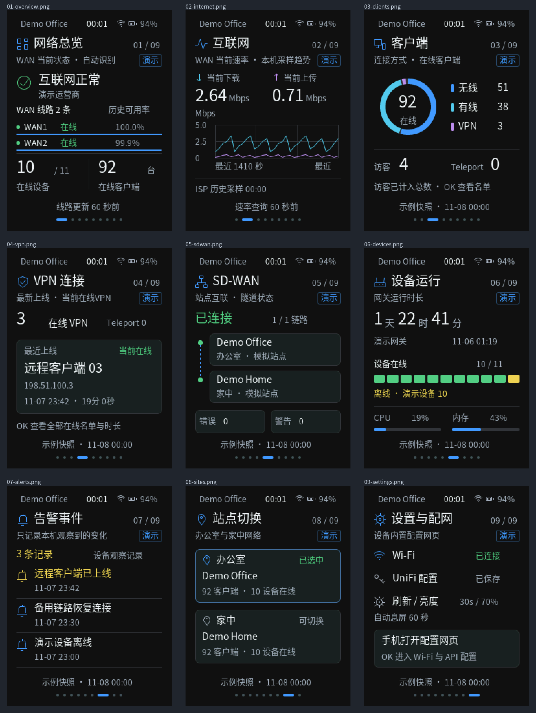

<p align="right">
  <a href="README.zh_CN.md">简体中文</a> · <strong>English</strong>
</p>

# UniFi Passport

A pocket UniFi network dashboard for **FoloToy AI Passport**. Check WAN traffic,
connected clients, VPN sessions, devices and site status on a 240 × 320 display,
using three physical buttons and a Chinese interface.

The ESP32-C3 connects directly to UniFi over HTTPS. Configure Wi-Fi and the API
key from your phone through the device's temporary setup hotspot; no always-on
computer, NAS or Python gateway is required.

[Quick start](#quick-start) · [Pages and controls](#pages-and-controls) ·
[Build](#build-and-validate) · [Application details](docs/development/unifi-dashboard.md)

## Preview



Offline renders from the firmware's LVGL drawing code and bundled fonts, using
explicitly labelled synthetic demo data. These are not device photographs or
live network readings. The device interface is Chinese; documentation is
available in both English and Chinese.

## Features

- Nine pages with menus and details: Overview, Internet, Clients, VPN, SD-WAN,
  Devices, Events, Sites and Settings.
- Current WAN download/upload polling and recent trends, plus cloud ISP
  latency/loss history with separate sample timestamps.
- Wireless/wired distribution, current VPN/Teleport sessions, device uptime,
  and CPU/memory/uplink statistics when supplied by the API.
- Cloud Site Manager and LAN Network API modes, site discovery and saved selection.
- Phone setup for Wi-Fi, API credentials, brightness, refresh interval,
  automatic screen off and demo mode.
- Beijing time (UTC+8), Wi-Fi and battery indicators; a wake gesture does not
  accidentally change pages.
- Read-only UniFi requests, explicit stale/partial/error states, and an
  offline demo mode that needs no UniFi account.

## Requirements

| Item | Requirement |
| --- | --- |
| Board | FoloToy AI Passport: ESP32-C3, 8 MB Flash, no PSRAM |
| Interface | 240 × 320 portrait display and Up / Down / OK buttons |
| Network | 2.4 GHz Wi-Fi with access to the selected UniFi endpoint |
| Cloud mode | Site Manager API key; Network details also need Connector/API permissions |
| LAN mode | Compatible Network API key and a reachable private IPv4 HTTPS console address |
| Source build | ESP-IDF **5.5.3**, Python 3 and a host C compiler |
| Flashing | USB data cable and the device's serial port |

Board definitions live in [the BSP](components/bsp/include/bsp_pins.h). Available
fields depend on console version and API permissions.

## Quick start

1. Build and install the firmware using the instructions below.
2. Join the `Passport-...` Wi-Fi hotspot shown on the unconfigured device.
   The current hotspot password is **`12345678`**.
3. Open **<http://192.168.4.1>** on the phone. Stay connected if it reports no
   Internet access. No additional setup code is required.
4. Scan for or enter your **2.4 GHz** Wi-Fi, save its password, and wait for
   the device to connect.
5. Choose **Cloud** or **LAN**, enter the appropriate API key, and save/test.
   Allow time for clock synchronization and discovery, then select your site.
6. Set brightness, refresh interval and screen-off timeout, then close the
   hotspot. Reopen it later from **Settings → Open setup hotspot**.

The hotspot accepts one phone and closes automatically after ten minutes.
Leaving an existing secret field blank preserves it; explicit clear controls
remove it. Credentials and settings are saved in device NVS, not compiled into
firmware. The portal does not read saved secrets back to the browser.

LAN mode requires a valid certificate chain and a certificate identity matching
the console IP. Provide a suitable PEM trust certificate in the portal when
needed; TLS verification cannot be disabled. Cloud mode uses the built-in CA
bundle. Both modes need a valid network clock.

Setup uses HTTP within the temporary WPA2 hotspot. This version does not enable
Flash/NVS encryption, so physical Flash access can reveal credentials. Keep
personal API keys, Wi-Fi passwords and device logs out of Git. The optional
gateway's `.env.example` contains placeholders only.

## Pages and controls

| Page | Display |
| --- | --- |
| Overview | Reported Internet/WAN availability, device and client counts |
| Internet | Current WAN rates, recent samples, cloud latency/loss details |
| Clients | Connected totals, wireless/wired distribution, paginated clients |
| VPN | Current VPN/Teleport sessions, IPs and connection durations |
| SD-WAN | Available Mesh/tunnel state, peer information and reported issues |
| Devices | Online/offline state, uptime and available device statistics |
| Events | Up to eight changes observed locally during this boot |
| Sites | Discovered sites and saved selection |
| Settings | Wi-Fi/IP, data mode, setup hotspot and display settings |

| Button | Action |
| --- | --- |
| Up / Down | Switch main pages, or move through the current menu/list |
| Short OK | Open a page menu or confirm the selection |
| Long OK | Return from a menu/detail; from a main page, return to Overview |
| Any button with the screen off | Wake only; press again to navigate |

The default screen-off timeout is **60 seconds**; options are 30 seconds,
1 minute, 2 minutes, 5 minutes or always on. Wi-Fi and polling continue while
the screen is off. Polling defaults to **30 seconds**; requests, caches and API
backoff can delay fresh data.

## Build and validate

```bash
git clone https://github.com/ZengWenJian123/aipassport-unifi.git
cd aipassport-unifi
```

Install and activate ESP-IDF 5.5.3 using the
[environment guide](docs/development/engineering/environment-setup.md).
In the activated ESP-IDF terminal:

```bash
idf.py --version             # ESP-IDF v5.5.3
./tools/validate.sh --static  # repository checks and host tests
./tools/validate.sh          # complete gate, including firmware build
```

The complete gate builds from `sdkconfig.defaults` in an isolated directory,
checks the Flash layout and retains:

```text
build/FoloToy-AI-Passport-full.bin  Verified merged image, flash at 0x0
build/firmware/<sha256>/           Matching images, ELF, MAP and manifest
```

`./tools/validate.sh --firmware` runs only the firmware portion. Build output
is excluded from Git. Generated Chinese font sources are included; ordinary
builds do not require font regeneration.

For a blank device or an intentional complete refresh, replace `PORT` with
your serial port and flash the verified merged image:

```bash
python -m esptool --chip esp32c3 --port PORT write_flash \
  0x0 build/FoloToy-AI-Passport-full.bin
```

**A merged flash can reset saved Wi-Fi/API settings.** To preserve them, use a
compatible segmented workflow from the
[firmware/data policy](docs/development/engineering/firmware-layout.md#flashing-and-stored-data).
The default table contains NVS, PHY data and one factory app, with no OTA slots.
Do not flash an application-only image at `0x0`.

Host tests and compilation do not establish hardware acceptance. Check the
screen/buttons, provisioning, API permissions and reconnect behavior on your
device; measure power before making battery-life claims.

## Current limits

- Real **seven-day traffic totals are unavailable** pending a verified
  byte-counter source. Demo traffic bars are synthetic.
- VPN details show current connections, not all configured or historical users.
  Client scans are bounded at 300 records and report partial coverage.
- Up to eight cloud sites and twelve devices are retained; a client page holds
  six records. SD-WAN currently handles one configuration.
- LAN mode has no cloud ISP history or Site Manager SD-WAN data. Controller
  compatibility endpoints for WAN/VPN can vary by Network version.
- Events are local observations, not the full UniFi log. Missing data remains
  unavailable rather than being reported as zero.
- There are no UniFi configuration writes, gateway reboots or SD-WAN reconnection
  commands. Screen off is not deep sleep.

See the [application guide](docs/development/unifi-dashboard.md) for API
semantics, resource bounds, compatibility and recorded acceptance results.

## Repository map

| Path | Purpose |
| --- | --- |
| `main/unifi_*` | Dashboard, model, LVGL renderer, direct API client and setup portal |
| `components/bsp/` | Shared board drivers and hardware interfaces |
| `assets/fonts/` | Chinese font sources, generated C assets and font license |
| `tests/` | Host tests, fake API responses and native LVGL preview harness |
| `tools/` | Validation, firmware verification and font/preview tools |
| `gateway/` | Optional legacy Python gateway; current firmware does not use it |
| `docs/` | Application, board, build and contribution documentation |
| `skills/` | Repository AI development workflows |

For AI-assisted development, start with [AGENTS.md](AGENTS.md). Further reading:
[upstream platform docs](docs/README.md),
[fonts and preview generation](assets/README.md),
[legacy gateway](gateway/README.md).

## License and credits

Based on [FoloToy/ai-passport](https://github.com/FoloToy/ai-passport), retaining
its BSP, development tools and upstream history. Project code uses the
[MIT License](LICENSE); bundled Noto Sans CJK fonts use
[SIL Open Font License 1.1](assets/fonts/unifi_OFL.txt).
