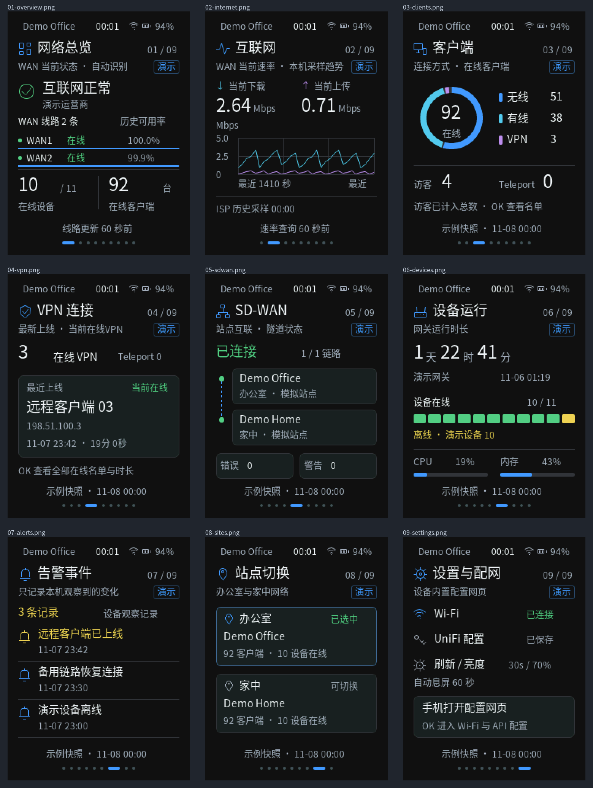

<p align="right">
  <strong>简体中文</strong> · <a href="README.md">English</a>
</p>

# UniFi Passport

基于 **FoloToy AI Passport** 的随身 UniFi 网络仪表盘，使用中文界面、240 × 320
屏幕和三个实体按键。ESP32-C3 通过 HTTPS 直接查询 UniFi，无需电脑或 NAS
网关常驻运行。

**应用源码和完整说明请使用
[`feature/unifi-dashboard`](https://github.com/ZengWenJian123/aipassport-unifi/tree/feature/unifi-dashboard)
分支。** 当前 `main` 分支保留上游 AI Passport 固件基线和项目入口；编译 `main`
得到的是硬件测试演示，不是 UniFi 应用。

## UniFi 仪表盘应用



图片为使用模拟数据生成的离线 LVGL 渲染，不是设备实拍或真实网络读数。

应用包含总览、互联网、客户端、VPN、SD-WAN、设备、事件、站点和设置九个页面。
上/下按键负责导航，短按确定打开菜单或确认，长按确定返回。主要功能包括：

- 轮询当前 WAN 下载/上传速率及趋势，查看云端 ISP 延迟与丢包。
- 查看在线客户端、VPN/Teleport 会话、设备运行时间和可用统计。
- 支持云端 Site Manager 或局域网 Network API，并保存站点选择。
- 手机通过临时 Wi-Fi 热点配置，不把密钥写入源码。
- 支持亮度、刷新间隔、自动熄屏、北京时间和离线演示模式。
- API 操作只读，明确显示缺失、过期、部分结果和错误状态。

实际数据取决于控制台版本与 API 权限。真实模式暂不提供七日流量总量，演示柱状图
为模拟数据。熄屏不等于深度睡眠；不执行 UniFi 配置写入或重启命令。

## 获取应用

```bash
git clone --branch feature/unifi-dashboard https://github.com/ZengWenJian123/aipassport-unifi.git
cd aipassport-unifi
```

硬件要求：FoloToy AI Passport、ESP32-C3、8 MB Flash、无 PSRAM、2.4 GHz Wi-Fi。
使用 **ESP-IDF 5.5.3** 编译。应用分支包含完整源码、中文字库、测试和配置网页。

| 文档 | 内容 |
| --- | --- |
| [应用中文 README](https://github.com/ZengWenJian123/aipassport-unifi/blob/feature/unifi-dashboard/README.zh_CN.md) | 配置、九个页面、按键、编译烧录命令与当前限制 |
| [应用设计说明](https://github.com/ZengWenJian123/aipassport-unifi/blob/feature/unifi-dashboard/docs/development/unifi-dashboard.zh_CN.md) | API 语义、资源边界与已记录的验证结果 |
| [上游平台文档](docs/README.zh_CN.md) | 硬件、BSP、环境和开发规则 |
| [AI 开发说明](AGENTS.zh_CN.md) | AI 辅助修改时必须遵循的仓库工作流 |

首次配置时，连接设备显示的 `Passport-...` 热点，密码为 `12345678`，打开
<http://192.168.4.1>。填写 Wi-Fi 和对应 API Key，选择站点后关闭热点。
局域网 TLS 要求、凭据存储和保留设置的固件更新方式详见应用 README。
合并镜像烧录可能重置已有设置，编译成功不代表硬件验收通过。

## 烧录与 API Key

请阅读[网页烧录和 API Key 教程](docs/assets/setup.zh_CN.md)，包含
[AI Passport 网页烧录工具](https://ai-passport.folotoy.cn/tools/web-flasher/)、
串口选择、合并镜像 `0x0`、保留设置的分段更新，以及
[UniFi API Key 创建](https://unifi.ui.com/settings/api-keys)步骤。
真实凭据只填写到设备，公开截图使用虚构数据。

## 分支与致谢

| 分支 | 职责 |
| --- | --- |
| `main` | 上游固件基线，仅增加本仓库的 README 和文档图片 |
| `feature/unifi-dashboard` | 完整 UniFi 应用及其文档 |

基于 [FoloToy/ai-passport](https://github.com/FoloToy/ai-passport)，保留上游历史和
[MIT 许可证](LICENSE)。应用分支中的 Noto Sans CJK 字体使用 SIL Open Font
License 1.1。
